# Münzwerk

**Ein selbst gehostetes Haushaltsbuch.** Münzwerk holt die Umsätze deines Bankkontos
automatisch ab (PSD2 über [Enable Banking](https://enablebanking.com)), sortiert sie
in Kategorien, erkennt Fixkosten und zeigt dir, wie viel bis Monatsende übrig ist.
Es läuft auf deinem eigenen kleinen Server – zum Beispiel einem Raspberry Pi zu
Hause – und kommt wie eine App auf den Homescreen deines Handys.

🇬🇧 [English version](README.md)

> [!IMPORTANT]
> **Hobbyprojekt – Nutzung auf eigenes Risiko.**
> Münzwerk ist ein privates Hobbyprojekt, das in der Freizeit gepflegt wird. Es wird
> so bereitgestellt, wie es ist, **ohne jede Gewähr** (siehe Abschnitte 15 und 16 der
> [Lizenz](LICENSE)). Beträge, Kategorien und Prognosen können falsch sein, und
> **nichts in dieser App ist Finanz-, Steuer- oder Rechtsberatung**.
> Münzwerk steht **in keiner Verbindung zu** ING, Enable Banking oder einer anderen
> Bank bzw. einem Anbieter und wird von ihnen weder unterstützt noch empfohlen. Die
> Namen stehen hier nur, um zu beschreiben, womit Münzwerk funktioniert.
> Für eine echte Bankverbindung brauchst du **ein eigenes Konto und einen eigenen
> Schlüssel bei Enable Banking**. Für deine Daten und die Einhaltung der Bedingungen
> deiner Bank und von Enable Banking bist du selbst verantwortlich.

## Bilder

Aufnahmen aus der Vorschau mit erfundenen Beispieldaten.

| Übersicht | Prognose | Umsätze |
|:-:|:-:|:-:|
| 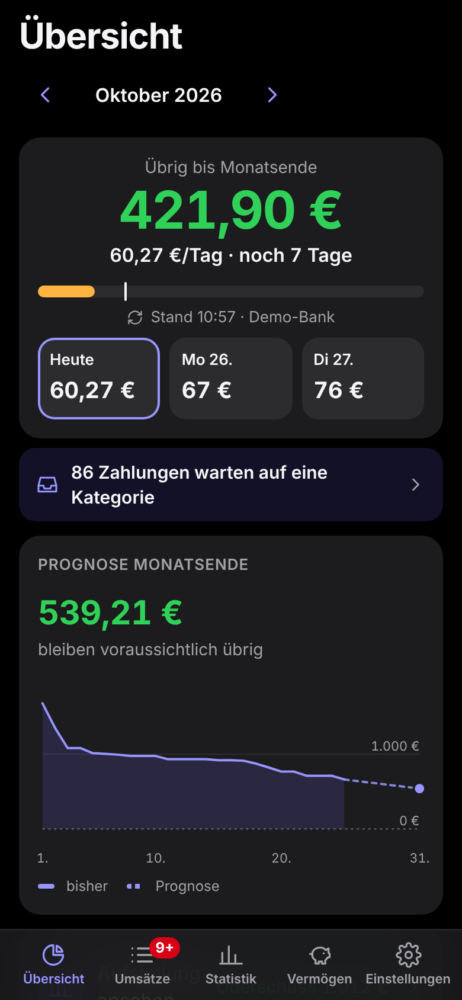 | 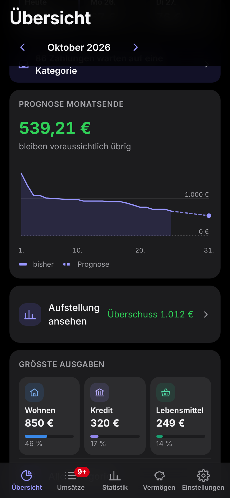 | 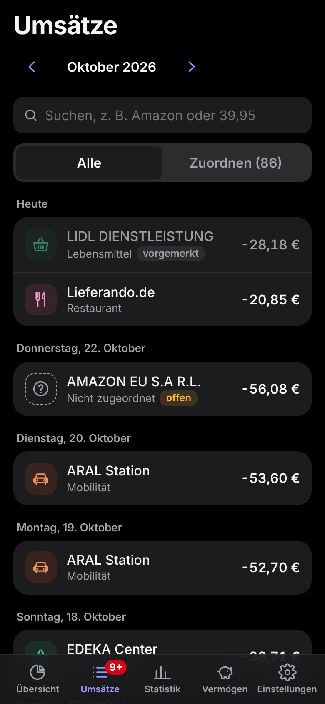 |
| **Zuordnen** | **Suche** | **Statistik Monat** |
| 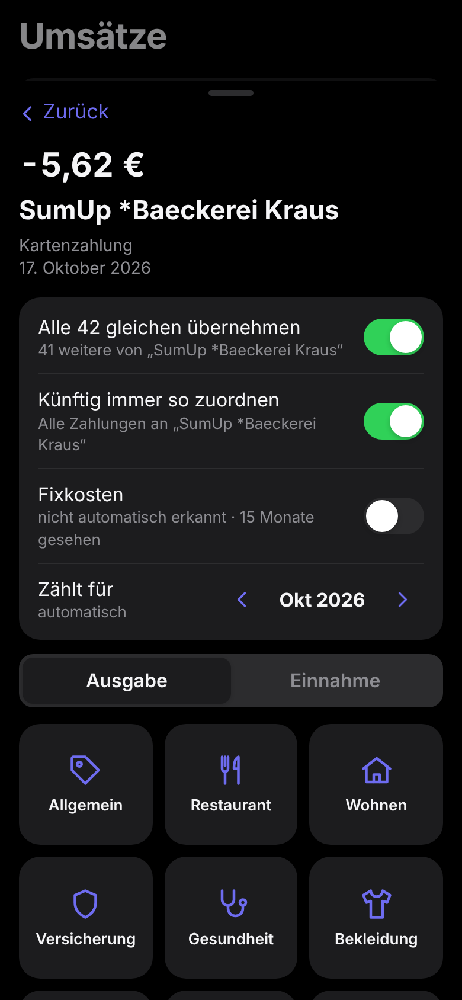 | 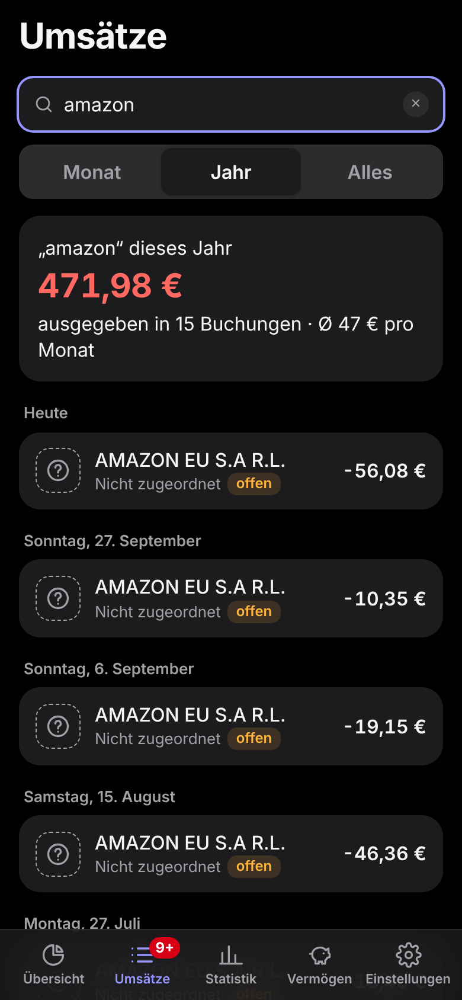 | 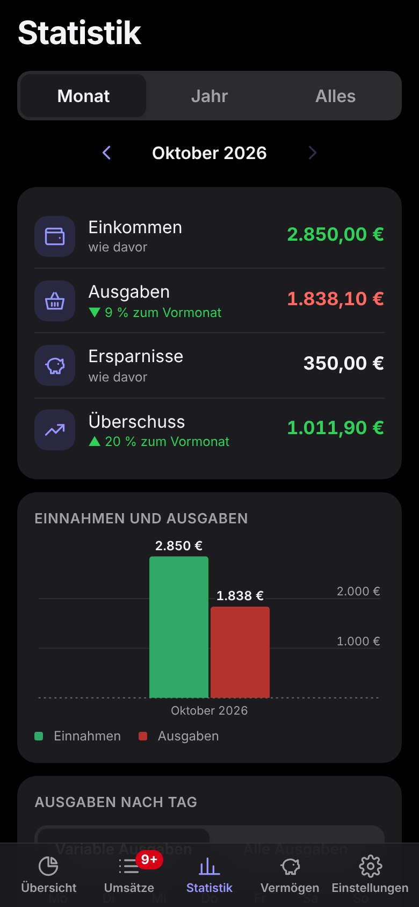 |
| **Statistik Jahr** | **Vermögen** | **Kredit** |
| 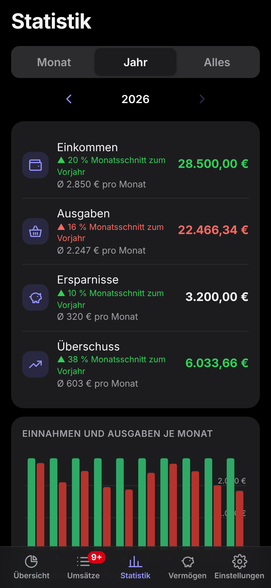 | 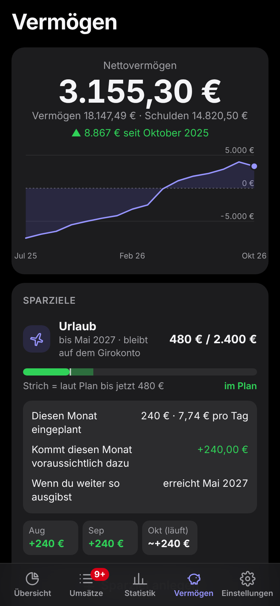 | 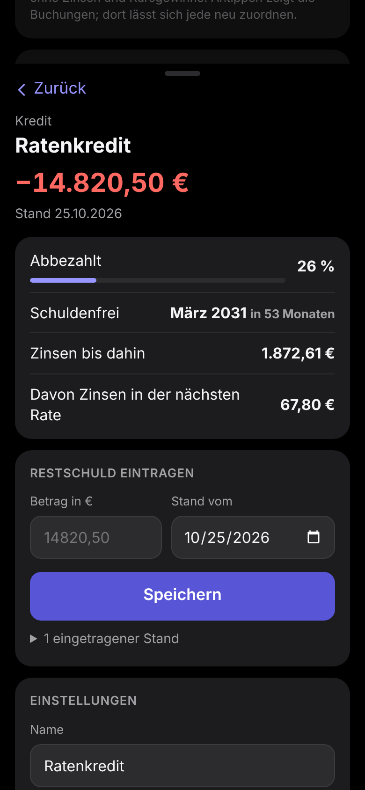 |
| **Fixkosten** | **Heller Modus** | |
| 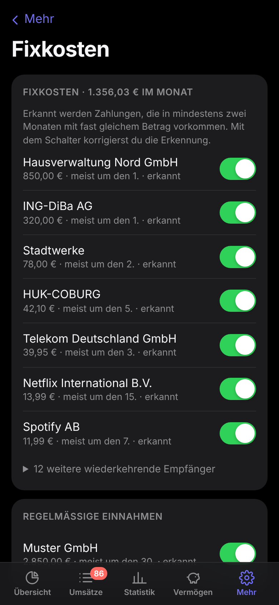 | 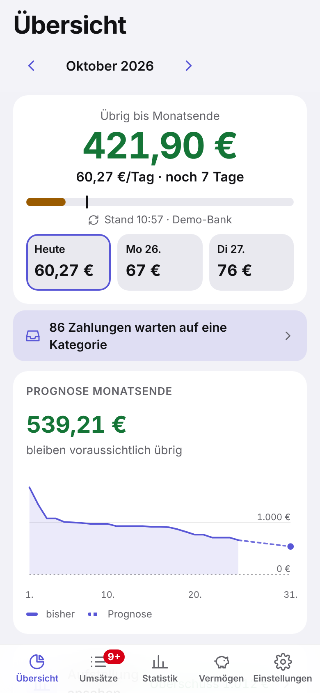 | 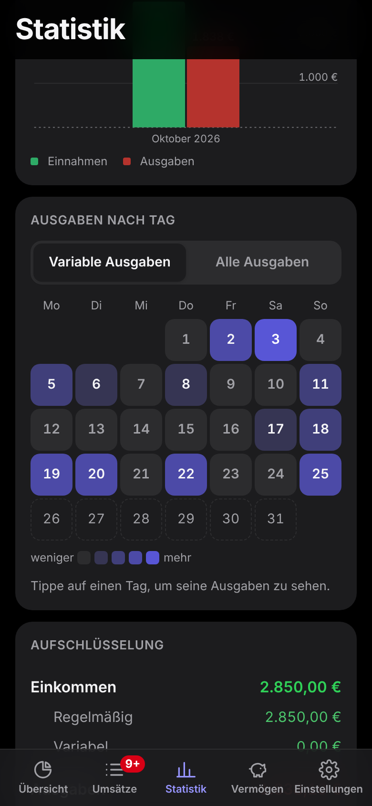 |
| 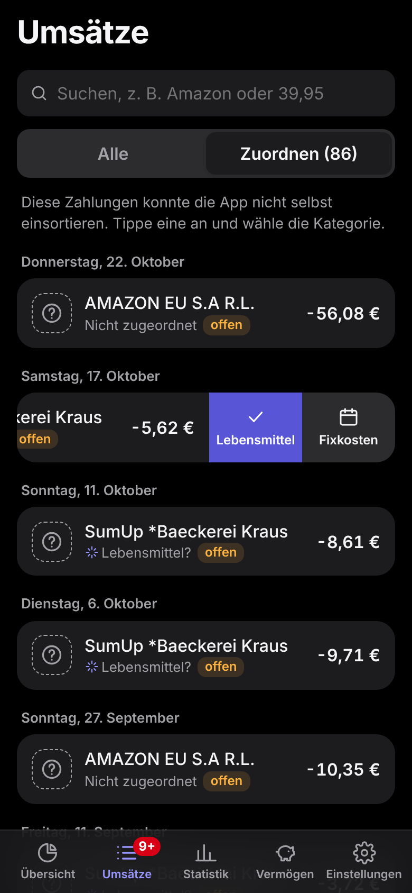 | 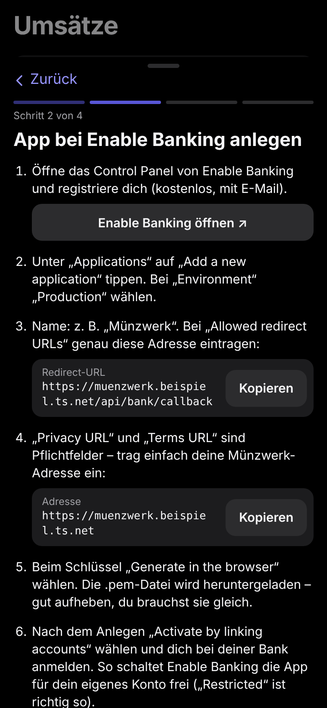 | |

## Was Münzwerk kann

- **Automatisch einsortieren** – Regeln wie „REWE → Lebensmittel“. Rund 45 Start-Regeln
  für bekannte Läden und Empfänger sind dabei.
- **Lernt mit** – Zahlungen ohne passende Regel warten unter „Zuordnen“. Ordnest du eine
  zu, merkt sich Münzwerk den Empfänger, sortiert ähnliche offene Zahlungen sofort mit ein
  und erkennt sie bei künftigen Abrufen selbst. Die letzten 20 Zuordnungen lassen sich
  rückgängig machen.
- **Gehalt für den Folgemonat** – Einnahmen in Kategorien mit „zählt zum Folgemonat“
  (Standard: Gehalt) zählen ab einem einstellbaren Tag (Standard: 15.) zum nächsten
  Monat. Einzelne Umsätze lassen sich auch von Hand verschieben.
- **Fixkosten-Erkennung** – Zahlungen an denselben Empfänger in mindestens zwei Monaten,
  höchstens zweimal im Monat und mit höchstens 30 % Schwankung gelten als Fixkosten
  (bei Einnahmen: regelmäßig). Pro Empfänger korrigierbar.
- **Übersicht** – Übrig bis Monatsende (offene Fixkosten schon abgezogen), Tagesbudget
  mit Vorschau, Prognose zum Monatsende und Aufstellung nach Einkommen, Fixkosten,
  variablen und großen Ausgaben, Ersparnissen und Überschuss.
- **Vorgemerkte Umsätze** – Kartenzahlungen, die die Bank noch nicht gebucht hat,
  erscheinen sofort (grau) und zählen schon ins Budget. Kommt die Buchung, ersetzt sie
  die Vormerkung und behält deine Kategorie.
- **Statistik** – Monat, Jahr oder alles; Einnahmen und Ausgaben, Vergleich zum
  Vorzeitraum, Angespartes über die Zeit, Ausgaben nach Kategorie oder Fixkosten.
- **Vermögen** – Girokonten, Sparkonten, Depots und Kredite mit Nettovermögen und Verlauf.
  Was die Bank liefert, kommt automatisch; alles andere trägst du ab und zu ein, dazwischen
  rechnet Münzwerk mit deinen Umbuchungen weiter. Kredite mit Tilgungsplan.
- **Ausgaben-Heatmap** – ein Kalender in der Statistik zeigt, an welchen Tagen das Geld rausgeht;
  Antippen zeigt die Buchungen des Tages, dazu eine Jahresansicht mit dem Schnitt je Wochentag.
- **Sparziele** – das Geld bleibt auf dem Girokonto: Betrag und Datum festlegen, Münzwerk plant die Rate im
  Tagesbudget ein und sagt dir anhand deines tatsächlichen Ausgebens, ob du es schaffst.
- **Mitteilung „Gehalt ist da“** – sobald ein Abruf dein Gehalt findet, kommt eine Mitteilung aufs Handy
  (Homescreen-App, iOS 16.4+). Ende-zu-Ende verschlüsselt; der Betrag lässt sich ausblenden.
- **Kategorie-Vorschläge** – für neue Empfänger schlägt Münzwerk die wahrscheinlichste Kategorie aus
  ähnlichen Zahlungen vor; übernehmen mit einem Tippen oder per Wischen nach links (Wischen markiert auch Fixkosten).
- **Auffälligkeiten** – ein Hinweis, wenn eine Kategorie deutlich über dem liegt, was du sonst bis zu diesem
  Tag ausgibst, oder wenn derselbe Betrag zweimal kurz hintereinander an denselben Empfänger ging. Wegklickbar.
- **Monatsrückblick** – in den ersten Tagen eines Monats: was übrig blieb, größte Ausgabe, Vergleich zum
  Vormonat, Sparziele. Wie viele Tage er bleibt, stellst du ein; wegklickbar.
- **Suche** – Empfänger, Verwendungszweck, Kategorie, Betrag (z. B. `39,95`) oder Datum,
  mit Summen für Monat, Jahr oder insgesamt.
- **Bankfreigabe im Blick** – die PSD2-Freigabe läuft nach 90–180 Tagen ab. Münzwerk zeigt
  das Datum, warnt eine Woche vorher und bietet „Neu verbinden“ an.
- **Anmeldung per Passkey** – Face ID / Fingerabdruck, sperrt sich nach 15 Minuten.
- **iPhone-Widget** – Übrig und Tagesbudget auf dem Home- oder Sperrbildschirm, über die
  kostenlose App [Scriptable](https://scriptable.app) und einen nur lesenden Widget-Schlüssel.
- **Deutsch und Englisch** – richtet sich nach der Sprache des Geräts, umschaltbar unter „Einstellungen“.

## Aufbau

```
 Handy (Web-App auf dem Homescreen)
        │  HTTPS, nur im eigenen Tailscale-Netz
        ▼
 Dein Server (z. B. Raspberry Pi) ── Docker: FastAPI + SQLite
        │  PSD2, nur lesend
        ▼
 Enable Banking ── deine Bank
```

- **Server:** Python, FastAPI, SQLite (`app/`)
- **Oberfläche:** reines HTML/CSS/JavaScript ohne Build (`web/`); die Auswertungen
  laufen im Browser (`web/analytics.js`)
- **Bankanbindung:** austauschbar über `BANK_PROVIDER` (`demo`, `enablebanking`, `none`), siehe `app/bank/`

Getestet ist Münzwerk bisher nur mit der **ING Deutschland**. Andere Banken bei Enable
Banking können funktionieren, liefern ihre Daten aber teils etwas anders – Rückmeldungen
sind willkommen.

## Ausprobieren

**[▶ Demo im Browser öffnen](https://vaitage.github.io/Muenzwerk/)** – läuft komplett im Browser mit
erfundenen Daten, nichts zu installieren, nichts wird gespeichert. Geht auch auf dem Handy (zum Home-Bildschirm
hinzufügen).

Die Demo selbst bauen:

```bash
python tools/build_demo.py      # erzeugt dist/demo.html
```

Oder den Server lokal mit der Demo-Bank starten:

```bash
pip install --require-hashes -r requirements.txt
HAUSHALTSBUCH_AUTH=0 uvicorn app.main:app --reload
```

Dann http://localhost:8000 öffnen und unter „Einstellungen“ die Demo-Bank verbinden.
(`HAUSHALTSBUCH_AUTH=0` schaltet die Anmeldung per Passkey ab – nur zum lokalen Testen.)

## Installation

Du brauchst einen kleinen Linux-Rechner, der durchläuft (ein Raspberry Pi 4 reicht, mit
Raspberry Pi OS 64 Bit), ein kostenloses [Tailscale](https://tailscale.com)-Konto und die
Tailscale-App auf dem Handy.

**Ein Befehl** – per SSH auf dem Pi als normaler Benutzer:

```bash
curl -fsSL https://raw.githubusercontent.com/Vaitage/muenzwerk/main/install.sh | bash
```

Das installiert Docker und Tailscale, holt Münzwerk nach `~/muenzwerk`, startet es und macht es
per HTTPS nur in deinem Tailnet erreichbar (`tailscale serve`, niemals `funnel`). Unterwegs
fragt es einmal das sudo-Passwort und zeigt einen Link zur Tailscale-Anmeldung. Am Ende steht
ein **QR-Code**: mit dem Handy scannen, Passkey anlegen (der Einrichtungscode ist schon
eingetragen), Seite zum Homescreen hinzufügen – den Rest erklärt die App. Mehrfach
ausführen schadet nicht.

Falls `tailscale serve` meckert: im Tailscale-Adminbereich unter *DNS* „MagicDNS“ und
„HTTPS Certificates“ einschalten und den Befehl nochmal starten.

<details><summary>Von Hand statt mit dem Befehl</summary>

```bash
git clone https://github.com/Vaitage/muenzwerk.git
cd muenzwerk
cp .env.example .env            # PUBLIC_URL und ALLOWED_HOSTS anpassen, siehe unten
docker compose up -d --build
sudo tailscale serve --bg 8000
docker exec haushaltsbuch python -m app.auth link   # Adresse mit Einrichtungscode
```
</details>

### Bank verbinden (Enable Banking)

In der App unter **„Einstellungen → Bank einrichten“** führt ein Assistent durch alles:

1. Kostenloses Konto bei [Enable Banking](https://enablebanking.com) und dort eine App
   („Production“) anlegen – die Redirect-URL zeigt der Assistent zum Kopieren an. Für die
   eigenen Konten reicht der kostenlose eingeschränkte Modus („Restricted“, Konto verknüpfen).
2. App-ID eintragen und die heruntergeladene `.pem`-Datei auswählen. Münzwerk speichert den
   Schlüssel nur auf deinem Server und prüft sofort bei Enable Banking, ob App-ID, Schlüssel
   und Redirect-URL zusammenpassen.
3. Bank aus der Liste wählen, verbinden und bei der Bank bestätigen.

Kein Terminal, kein Neustart. Wer lieber die `.env` nutzt: `BANK_PROVIDER=enablebanking`,
`ENABLEBANKING_APP_ID`, `ENABLEBANKING_KEY_FILE`, `ENABLEBANKING_BANK`, `ENABLEBANKING_COUNTRY`
gelten weiter; Angaben aus dem Assistenten haben Vorrang.

Der Zugriff ist nur lesend: Münzwerk kann Umsätze und Kontostände lesen, aber kein Geld
bewegen. Dein Online-Banking-Passwort sehen weder Münzwerk noch Enable Banking.

### Einstellungen (`.env`)

| Variable | Bedeutung |
|---|---|
| `DEFAULT_LANGUAGE` | `de` oder `en` – Sprache der Standardkategorien beim ersten Start |
| `BANK_PROVIDER` | `demo`, `enablebanking` oder `none` |
| `PUBLIC_URL` | Adresse der App (für die Rückleitung von der Bank) |
| `ALLOWED_HOSTS` | Adressen, unter denen die App antwortet, z. B. `localhost,127.0.0.1,*.ts.net` |
| `SYNC_INTERVAL_HOURS` | `0` schaltet den Abruf im Hintergrund aus; sonst Abstand in Stunden, wenn `SYNC_TIMES` leer ist |
| `SYNC_TIMES` | feste Uhrzeiten für den Abruf im Hintergrund, Ortszeit (Standard `06:30,10:00,14:00,20:00`) |
| `PUSH_CONTACT` | Kontakt im Absender-Ausweis für Mitteilungen, `mailto:…` oder `https://…` (Standard: `PUBLIC_URL`; Apple lehnt Platzhalter wie example.com ab) |
| `ENABLEBANKING_APP_ID`, `ENABLEBANKING_KEY_FILE` | deine App bei Enable Banking |
| `ENABLEBANKING_BANK`, `ENABLEBANKING_COUNTRY` | z. B. `ING` / `DE` |
| `AUTH_IDLE_MINUTES`, `AUTH_MAX_HOURS` | Sperre nach Inaktivität (Standard 15 Min.) / spätestens (12 Std.) |

Alle Passkeys verloren? `docker exec haushaltsbuch python -m app.auth zuruecksetzen`,
danach in der App mit dem angezeigten Einrichtungscode einen neuen anlegen.
Gerät verloren? Unter *Einstellungen → Anmeldung* seinen Passkey löschen – dabei werden auch alle
anderen Geräte abgemeldet. *Andere Geräte abmelden* tut das, ohne einen Passkey zu löschen.

### Updates aus der App (optional)

Münzwerk vom Handy aus aktualisieren, statt sich am Server anzumelden:

```bash
bash tools/pi/updates-einrichten.sh https://github.com/<du>/muenzwerk
```

Das trägt `UPDATES_IN_APP=1` in die `.env` dieser Installation ein. Unter „Einstellungen → Updates“ zeigt
die App dann den installierten Stand, ob es auf GitHub einen neueren gibt (stündlich geprüft, mit
Liste der Änderungen), und einen Knopf „Jetzt aktualisieren“. Automatisch eingespielt wird nichts.

Die App selbst fasst den Server nie an: Sie legt nur eine Ein-Wort-Anfrage in `data/update/` ab,
die ein kleiner Cron-Job auf dem Pi innerhalb einer Minute abholt. Übernommen werden nur
Fast-Forwards von `main`; lässt sich der neue Stand nicht bauen oder startet die App nicht, geht es
zurück auf den vorherigen. Bei einem privaten Fork legt die Einrichtung einen nur lesenden
SSH-Schlüssel an, den du einmal als *Deploy key* (ohne Schreibrecht) in den Repository-Einstellungen
einträgst. Protokoll: `~/kontor-update.log`, ausschalten mit `crontab -e`.

### iPhone-Widget (optional)

Unter „Einstellungen → iPhone-Widget“ erzeugst du einen Widget-Schlüssel und kopierst ein fertiges Skript
für die kostenlose App [Scriptable](https://scriptable.app) (die eigene Adresse setzt die App ein).
In Scriptable einfügen, einmal starten und den Schlüssel eingeben, dann ein Scriptable-Widget
hinzufügen (klein, mittel oder Sperrbildschirm) und das Skript wählen. Es zeigt, was bis
Monatsende übrig ist, das Tagesbudget für die nächsten drei Tage und die nächsten Fixkosten,
hell und dunkel.

Die Zahlen rechnet die App (genau wie in der Übersicht) und schickt sie bei jedem Öffnen an den
Server; das Widget zeigt diesen Stand und sagt, wie alt er ist. Wie oft Widgets neu laden,
entscheidet iOS. Das iPhone muss den Server erreichen (z. B. Tailscale an), sonst zeigt das
Widget den zuletzt geladenen Stand.

### Backups

Unter `tools/backup/` liegen Beispielskripte für verschlüsselte nächtliche Backups von
`data/` und `.env` (verschlüsselt auf dem Server für ein Zertifikat, dessen privater
Schlüssel nur auf deinem PC liegt). Sichere `data/` auf jeden Fall irgendwie – darin
liegen Datenbank und Bankschlüssel.

## Sicherheit

- **Nicht im Internet:** Der Container lauscht nur auf `127.0.0.1`; Zugriff über
  Tailscale von den eigenen Geräten.
- **Bankzugang nur lesend** über PSD2; die Rückleitung der Bank wird mit einem Zufallswert geprüft.
- **Fremde Texte werden entschärft:** Empfänger und Verwendungszweck stammen von Fremden
  (jeder kann dir 1 Cent mit beliebigem Text überweisen). Alles wird vor der Anzeige entschärft.
- **Adressprüfung** gegen DNS-Rebinding (`ALLOWED_HOSTS`) und eigener Header gegen CSRF.
- **Sicherheits-Header:** strenge Content-Security-Policy, kein Caching der Finanzdaten.
- **Anmeldung per Passkey:** ohne Anmeldung liefert die Schnittstelle keine Daten. Der
  erste Passkey braucht den einmaligen Einrichtungscode aus dem Server-Log, weitere gehen
  nur nach Anmeldung. Wird ein Passkey gelöscht, enden alle anderen Sitzungen; jede
  Anmeldung nutzt ihre eigene, einmalige Challenge.
- **Widget-Schlüssel:** der einzige Zugang ohne Anmeldung. Er darf genau eine Sache lesen,
  `GET /api/widget/data` (Übrig, Tagesbudget, nächste Fixkosten – keine Umsätze, keine
  Kontodaten). Gespeichert wird nur ein Hash; ein neuer Schlüssel oder „Sperren“ macht den
  alten sofort ungültig.
- **Dateien:** Datenbank nur für den App-Benutzer lesbar; der Container läuft nicht als root.
- **Nicht verschlüsselt gespeichert:** Wer die SD-Karte mitnimmt, kann die Datenbank lesen.
  Die Backups sind verschlüsselt.

Eine Sicherheitslücke gefunden? Bitte vertraulich melden, siehe [SECURITY.md](SECURITY.md).

## Entwicklung

```bash
pip install --require-hashes -r requirements.txt && pip install pytest
pytest                                  # Server
node --test tests/*.test.mjs            # Auswertungen und Übersetzungen
python tools/build_demo.py && python tools/ui_pruefung.py   # Kontrast, Schriftgröße, Tippflächen (braucht Playwright)
python tools/build_demo.py              # Vorschau als eine HTML-Datei
python tools/screenshots.py de          # Bilder für diese README (braucht Playwright)
```

Neue Texte in der Oberfläche laufen über `t("Deutscher Text")` und brauchen eine
englische Fassung in `web/i18n.js` – der Test `tests/i18n.test.mjs` meldet fehlende.

Mitmachen: siehe [CONTRIBUTING.md](CONTRIBUTING.md).

## Lizenz

[GNU Affero General Public License v3.0](LICENSE). Wer eine veränderte Fassung für
andere über ein Netzwerk betreibt, muss ihnen den Quellcode anbieten.
