# Münzwerk

**A self-hosted household budget app.** Münzwerk fetches the transactions of your
bank account automatically (PSD2 via [Enable Banking](https://enablebanking.com)),
sorts them into categories, detects fixed costs and tells you how much money is
left until the end of the month. It runs on your own small server – for example
a Raspberry Pi at home – and installs on your phone's home screen like an app.

🇩🇪 [Deutsche Fassung](README.de.md)

> [!IMPORTANT]
> **Hobby project – use at your own risk.**
> Münzwerk is a private hobby project, maintained in spare time. It is provided
> "as is", **without any warranty** (see sections 15 and 16 of the [license](LICENSE)).
> Amounts, categories and forecasts may be wrong, and **nothing in this app is
> financial, tax or legal advice**.
> Münzwerk is **not affiliated with, endorsed or supported by** ING, Enable Banking
> or any other bank or provider. Their names are only used to describe compatibility.
> To connect a real bank you need **your own Enable Banking account and key**; you are
> responsible for your data and for following the terms of your bank and of Enable Banking.

## Screenshots

Taken from the demo with made-up data.

| Overview | Forecast | Transactions |
|:-:|:-:|:-:|
| 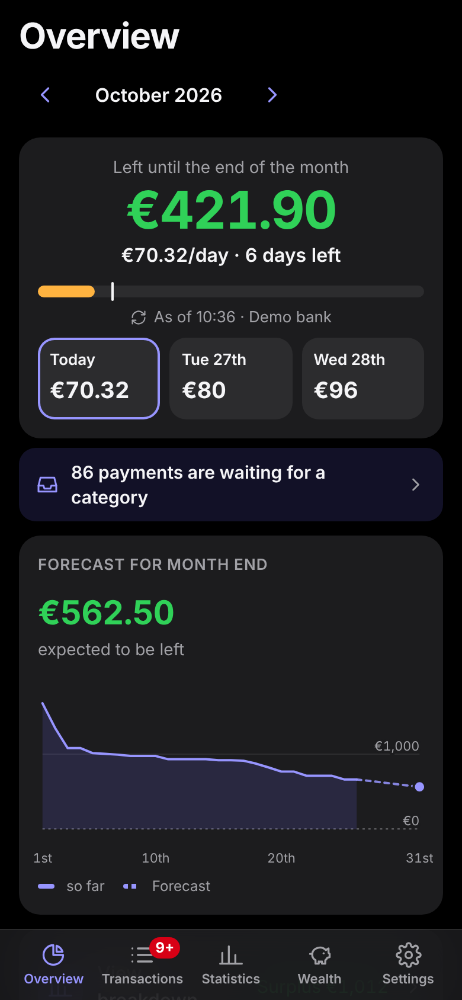 | 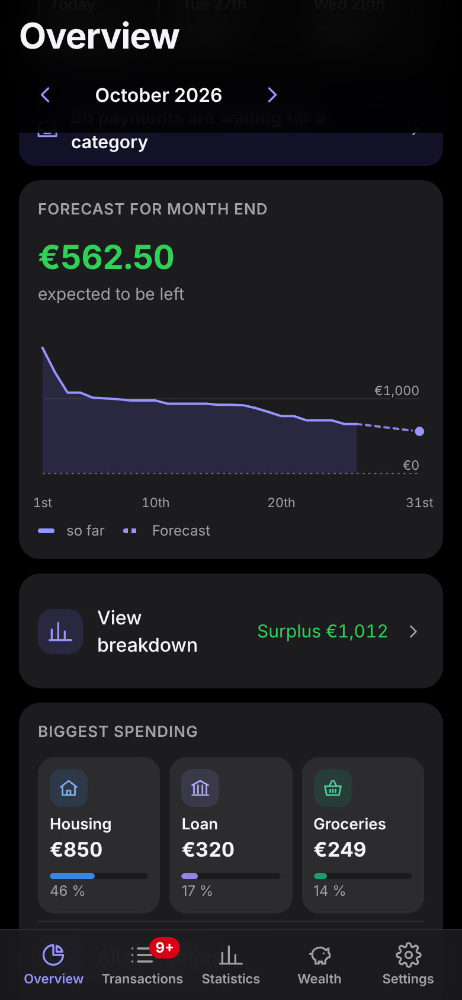 | 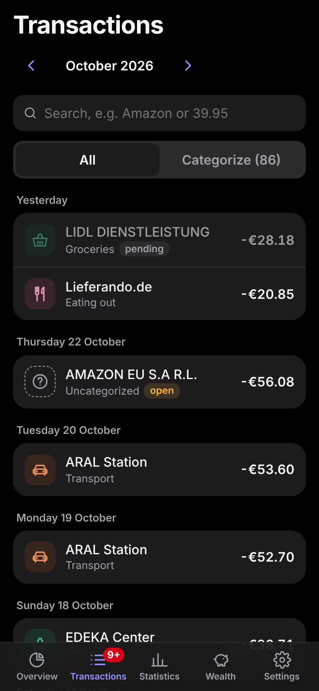 |
| **Categorize** | **Search** | **Statistics (month)** |
| 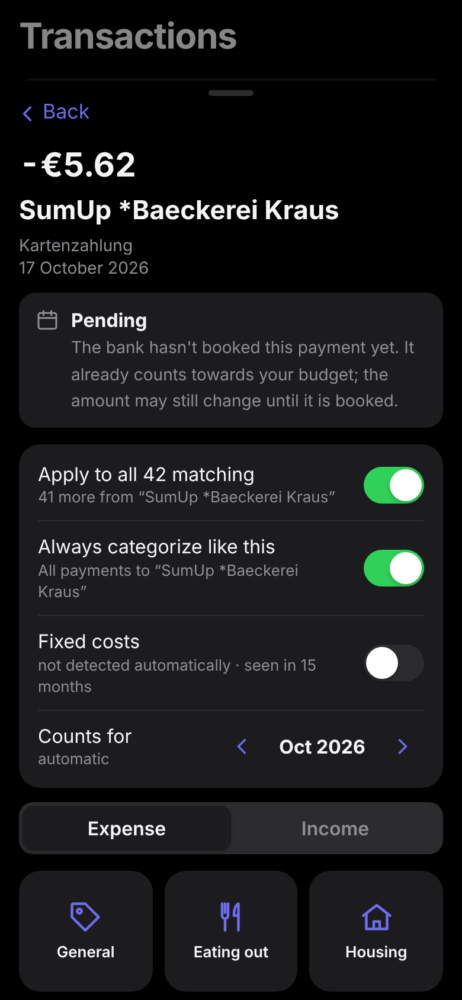 | 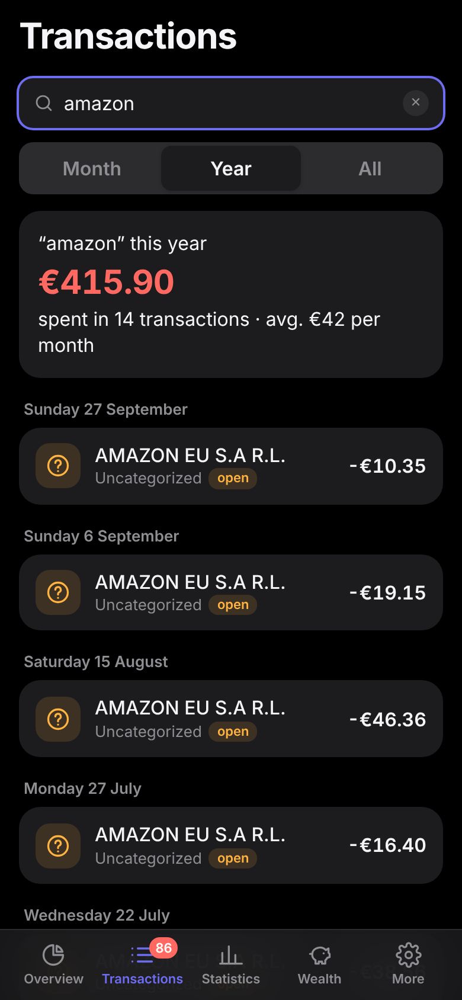 | 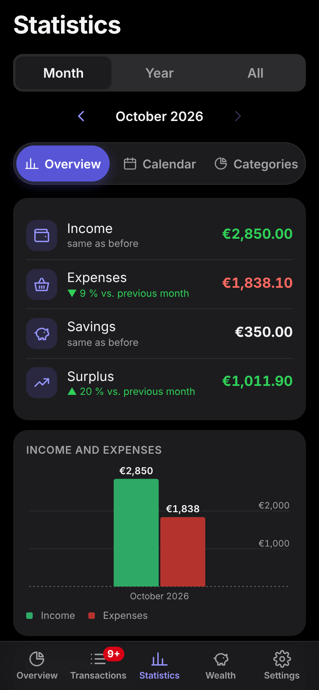 |
| **Statistics (year)** | **Wealth** | **Loan** |
| 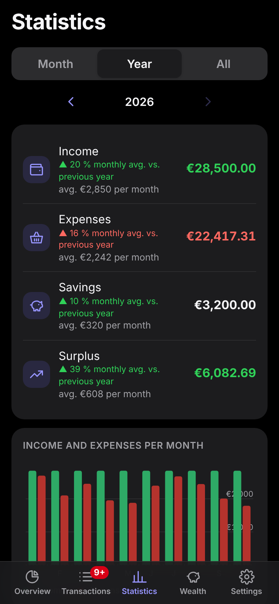 | 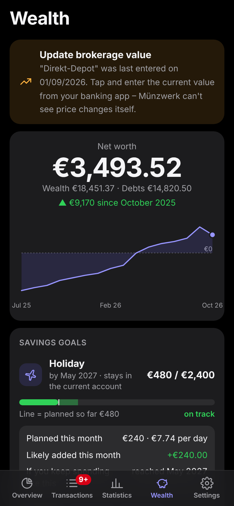 | 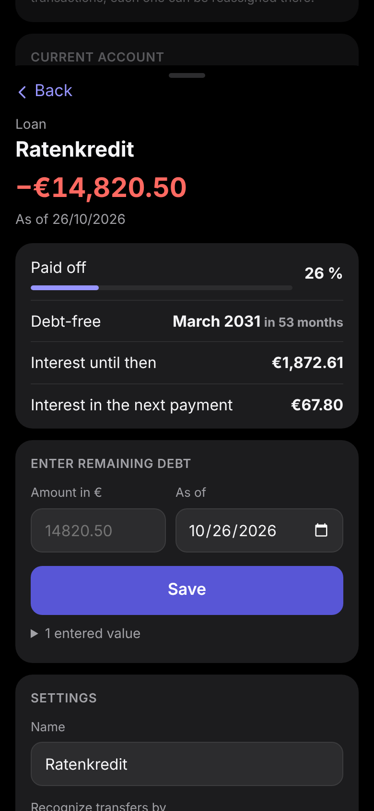 |
| **Fixed costs** | **Light mode** | |
| 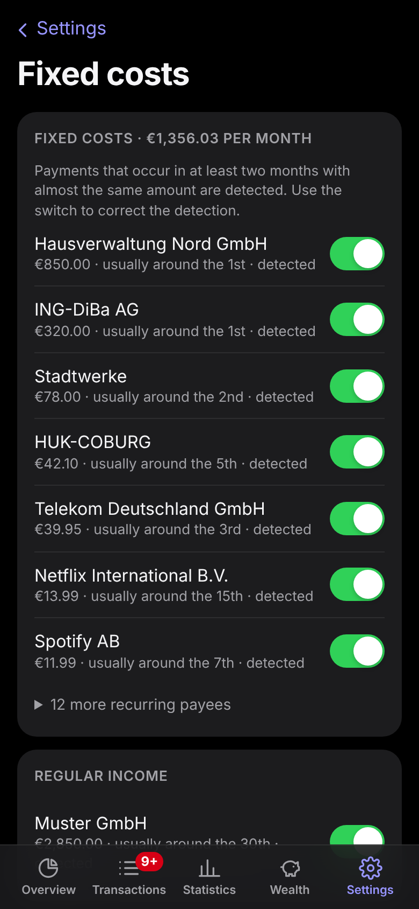 | 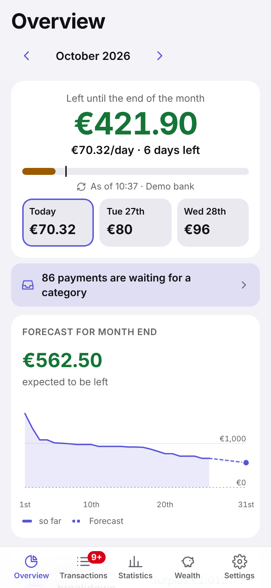 | 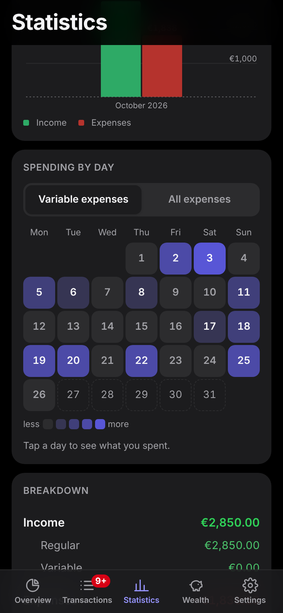 |
| 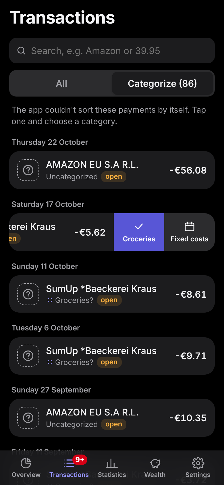 | 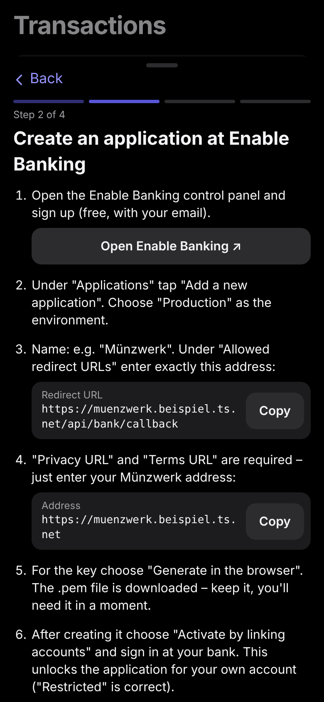 | |

## Features

- **Automatic categories** – rules like "REWE → Groceries". About 45 starter rules
  for common (mostly German) shops and payees are included.
- **Learns as you go** – payments without a matching rule wait under *Categorize*.
  Assign one and Münzwerk remembers the payee, sorts similar open payments right away
  and recognizes them in future fetches. The last 20 assignments can be undone.
- **Salary for next month** – income in categories marked *counts for next month*
  (default: salary) counts towards the following month from a day you choose
  (default: the 15th). Single transactions can also be moved by hand.
- **Fixed-cost detection** – payments to the same payee in at least two months,
  at most twice a month and within 30 % of each other count as fixed costs
  (or regular income). You can correct this per payee.
- **Overview** – money left until the end of the month (upcoming fixed costs
  already deducted), a daily budget with a preview for the next days, a forecast
  for the end of the month and a breakdown of income, fixed, variable and large
  expenses, savings and surplus.
- **Pending transactions** – card payments the bank has not booked yet show up
  immediately (greyed out) and already count towards the budget. When the booking
  arrives it replaces the pending entry and keeps your category.
- **Statistics** – month, year or everything; income vs. expenses, comparison with
  the previous period, savings over time, expenses by category or by fixed cost.
- **Wealth** – current accounts, savings, brokerage accounts and loans with net
  worth over time. What comes in automatically depends on your bank: many (e.g. ING) only
  share the current account via PSD2. Savings and brokerage accounts you enter now and then;
  in between Münzwerk adds your transfers (and, if you like, savings interest) and reminds you
  when a brokerage value is getting old. Loans run on their own with a repayment plan
  (interest, debt-free date, whether this month's instalment went out).
- **Spending heatmap** – a calendar under *Statistics* shows on which days the money goes;
  tap a day for its transactions, plus a year view with the average per weekday.
- **Savings goals** – the money stays in your current account: set an amount and a date, Münzwerk plans
  the monthly instalment into your daily budget and tells you, from how you actually spend, whether you'll make it.
- **"Your salary is in" notification** – as soon as a fetch finds your salary, your phone gets a
  notification (home-screen app, iOS 16.4+). Encrypted end to end; the amount can be hidden.
- **Category suggestions** – for new payees Münzwerk suggests the most likely category from similar
  payments; accept it with one tap or by swiping left in the list (swipe also marks fixed costs).
- **Unusual spending** – a hint when a category is clearly above what you usually spend by this day of
  the month, or when the same amount went to the same payee twice within a few days. Dismissable.
- **Monthly review** – for the first days of a new month: what was left, biggest expense, comparison
  with the month before, savings goals. How many days it stays is up to you; dismissable.
- **Search** – payee, reference, category, amount (e.g. `39.95`) or date, with totals
  per month, year or overall.
- **Bank access monitoring** – PSD2 access expires after 90–180 days. Münzwerk shows
  when, warns a week ahead and offers *Reconnect*.
- **Passkey sign-in** – Face ID / fingerprint, locks itself after 15 minutes.
- **iPhone widget** – money left and today's daily budget on the home or lock screen,
  via the free app [Scriptable](https://scriptable.app) and a read-only widget key.
- **German and English** – follows your device language and can be switched under *Settings*.

## How it works

```
 Phone (home-screen web app)
        │  HTTPS, only inside your Tailscale network
        ▼
 Your server (e.g. Raspberry Pi) ── Docker: FastAPI + SQLite
        │  PSD2, read-only
        ▼
 Enable Banking ── your bank
```

- **Backend:** Python, FastAPI, SQLite (`app/`)
- **Frontend:** plain HTML/CSS/JavaScript without a build step (`web/`);
  the calculations run in the browser (`web/analytics.js`)
- **Bank access:** pluggable via `BANK_PROVIDER` (`demo`, `enablebanking`, `none`), see `app/bank/`

Münzwerk has only been tested with **ING Germany** so far. Other banks supported by
Enable Banking may work but can deliver data slightly differently – reports are welcome.

## Try the demo

**[▶ Open the live demo](https://vaitage.github.io/Muenzwerk/)** – runs completely in the browser with
made-up data, nothing to install, nothing is saved. Works on the phone too (add it to the home screen).

To build the demo yourself:

```bash
python tools/build_demo.py      # creates dist/demo.html
```

Or run the server locally with the demo bank:

```bash
pip install --require-hashes -r requirements.txt
HAUSHALTSBUCH_AUTH=0 uvicorn app.main:app --reload
```

Then open http://localhost:8000 and connect the demo bank under *Settings*.
(`HAUSHALTSBUCH_AUTH=0` switches off the passkey sign-in – for local testing only.)

## Installation

You need a small always-on Linux machine (a Raspberry Pi 4 with Raspberry Pi OS 64-bit is
plenty), a free [Tailscale](https://tailscale.com) account and the Tailscale app on your phone.

**One command** – over SSH on the Pi, as a normal user:

```bash
curl -fsSL https://raw.githubusercontent.com/Vaitage/muenzwerk/main/install.sh | bash
```

It installs Docker and Tailscale, fetches Münzwerk into `~/muenzwerk`, starts it and makes it
reachable via HTTPS inside your tailnet only (`tailscale serve`, never `funnel`). It asks for
your sudo password once and shows a link to sign the machine in to Tailscale. At the end you
get a **QR code**: scan it with your phone, create a passkey (the setup code is already filled
in), add the page to your home screen – the app explains the rest. Running it again is safe.

If `tailscale serve` complains, enable "MagicDNS" and "HTTPS Certificates" under *DNS* in the
Tailscale admin console and run the command again.

<details><summary>Manual install instead</summary>

```bash
git clone https://github.com/Vaitage/muenzwerk.git
cd muenzwerk
cp .env.example .env            # set PUBLIC_URL and ALLOWED_HOSTS, see below
docker compose up -d --build
sudo tailscale serve --bg 8000
docker exec haushaltsbuch python -m app.auth link   # address with setup code
```
</details>

### Connecting your bank (Enable Banking)

In the app, **Settings → Set up bank** opens a wizard that walks you through it:

1. Create a free account at [Enable Banking](https://enablebanking.com) and an application
   ("Production") – the wizard shows the redirect URL to copy. For your own accounts the free
   restricted mode is enough ("Restricted", link your account).
2. Enter the app ID and choose the downloaded `.pem` file. Münzwerk stores the key only on your
   server and checks right away with Enable Banking that app ID, key and redirect URL match.
3. Pick your bank from the list, connect and confirm at your bank.

No terminal, no restart. If you prefer `.env`: `BANK_PROVIDER=enablebanking`,
`ENABLEBANKING_APP_ID`, `ENABLEBANKING_KEY_FILE`, `ENABLEBANKING_BANK`, `ENABLEBANKING_COUNTRY`
still work; values from the wizard take precedence.

Access is read-only: Münzwerk can read transactions and balances but cannot move money,
and neither Münzwerk nor Enable Banking ever see your online banking password.

### Configuration (`.env`)

| Variable | Meaning |
|---|---|
| `DEFAULT_LANGUAGE` | `en` or `de` – language of the default categories created on first start |
| `BANK_PROVIDER` | `demo`, `enablebanking` or `none` |
| `PUBLIC_URL` | address the app is reachable at (for the redirect from the bank) |
| `ALLOWED_HOSTS` | host names the app answers to, e.g. `localhost,127.0.0.1,*.ts.net` |
| `SYNC_INTERVAL_HOURS` | `0` turns the background fetch off; otherwise the interval if `SYNC_TIMES` is empty |
| `SYNC_TIMES` | fixed background fetch times, local time (default `06:30,10:00,14:00,20:00`) |
| `PUSH_CONTACT` | contact in the sender ID for notifications, `mailto:…` or `https://…` (default: `PUBLIC_URL`; Apple rejects placeholders like example.com) |
| `ENABLEBANKING_APP_ID`, `ENABLEBANKING_KEY_FILE` | your Enable Banking application |
| `ENABLEBANKING_BANK`, `ENABLEBANKING_COUNTRY` | e.g. `ING` / `DE` |
| `AUTH_IDLE_MINUTES`, `AUTH_MAX_HOURS` | lock after inactivity (default 15 min) / at the latest (12 h) |

Lost all passkeys? Run `docker exec haushaltsbuch python -m app.auth zuruecksetzen`,
then create a new one in the app with the setup code it prints.
Lost a device? Delete its passkey under *Settings → Sign-in* – that also signs out every
other device. *Sign out other devices* does the same without deleting a passkey.

### Updates from the app (optional)

Update Münzwerk from your phone instead of logging into the server:

```bash
bash tools/pi/updates-einrichten.sh https://github.com/<you>/muenzwerk
```

This adds `UPDATES_IN_APP=1` to the `.env` of that installation. Under *Settings → Updates* the app
then shows the installed version, whether a newer one is available on GitHub (checked hourly,
with the list of changes) and an *Update now* button. Nothing is installed automatically.

The app itself never touches the server: it only leaves a one-word request in `data/update/`,
which a small cron job on the Pi picks up within a minute. That job only takes fast-forwards of
`main`; if the new version doesn't build or the app doesn't start, it goes back to the previous one.
For a private fork the setup creates a read-only SSH key, which you add once as a *deploy key*
(without write access) in the repository settings. Log: `~/kontor-update.log`; turn it off with
`crontab -e`.

### iPhone widget (optional)

Under *Settings → iPhone widget* you create a widget key and copy a ready-made script for the
free app [Scriptable](https://scriptable.app) (the app fills in its own address). Paste it into
Scriptable, run it once to enter the key, then add a Scriptable widget (small, medium or lock
screen) and choose the script. It shows money left until month end, the daily budget for the
next three days and the next fixed cost, in light and dark mode.

The numbers are calculated by the app (exactly as on the overview) and sent to the server
each time you open it; the widget shows that state and says how old it is. iOS decides how
often widgets refresh. The phone needs to reach the server (e.g. Tailscale on); otherwise
the widget shows the last state it loaded.

### Backups

`tools/backup/` contains example scripts for encrypted nightly backups of `data/`
and `.env` (encrypted on the server for a certificate whose private key only lives on
your PC). Back up `data/` one way or another – it holds your database and bank key.

## Security

- **Not on the internet:** the container listens on `127.0.0.1` only; access is through
  Tailscale from your own devices.
- **Read-only bank access** via PSD2; the bank redirect is checked with a random state.
- **Untrusted text is escaped:** payee and reference come from strangers (anyone can send
  you 1 cent with any text). Everything is escaped before display.
- **Host check** against DNS rebinding (`ALLOWED_HOSTS`) and a custom header against CSRF.
- **Security headers:** strict Content-Security-Policy, no caching of financial data.
- **Passkey sign-in:** without it, the API returns no data. The first passkey needs the
  one-time setup code from the server log, further ones can only be added after signing in.
  Deleting a passkey ends all other sessions; each sign-in uses its own one-time challenge.
- **Widget key:** the only access without a session. It can read exactly one thing,
  `GET /api/widget/data` (money left, daily budget, next fixed costs – no transactions or
  account details). Only a hash is stored; a new key or *Revoke* invalidates the old one at once.
- **Files:** the database is readable only by the app user; the container doesn't run as root.
- **Not encrypted at rest:** whoever takes the SD card can read the database. Backups are encrypted.

Found a vulnerability? Please report it privately, see [SECURITY.md](SECURITY.md).

## Development

```bash
pip install --require-hashes -r requirements.txt && pip install pytest
pytest                                  # server
node --test tests/*.test.mjs            # calculations and translations
python tools/build_demo.py && python tools/ui_pruefung.py   # contrast, text size, touch targets (needs Playwright)
python tools/build_demo.py              # demo as a single HTML file
python tools/screenshots.py en          # README images (needs Playwright)
```

```
app/
  main.py          web server (FastAPI) and API
  db.py            SQLite database and migrations
  defaults.py      default categories (de/en), starter rules, settings
  ledger.py        categorizing, budget month, import
  sync.py          fetching and monitoring bank access
  accounts.py      wealth: accounts and balances
  auth.py          passkey sign-in (WebAuthn)
  bank/            demo.py, enablebanking.py
web/               the app (HTML, CSS, JavaScript), i18n.js for translations
tools/             demo build, screenshots, Raspberry Pi and backup scripts
tests/             automated tests
```

Code comments and parts of the scripts are in German, since this started as a
personal German project. English contributions are very welcome – see
[CONTRIBUTING.md](CONTRIBUTING.md).

## License

[GNU Affero General Public License v3.0](LICENSE). If you run a modified version
for other people over a network, you have to offer them its source code.
